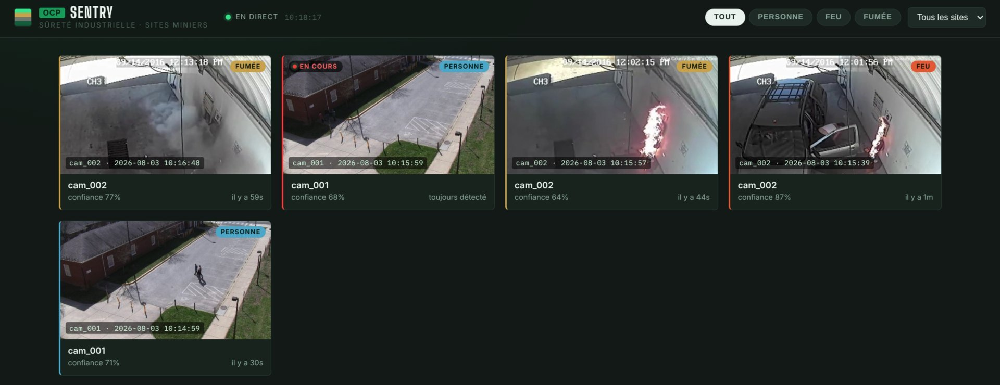
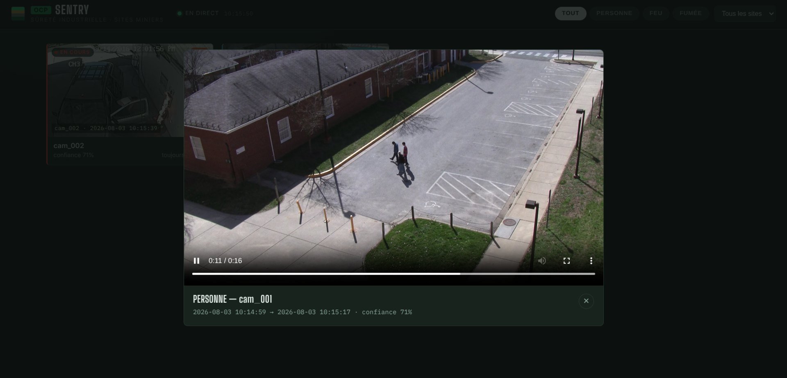
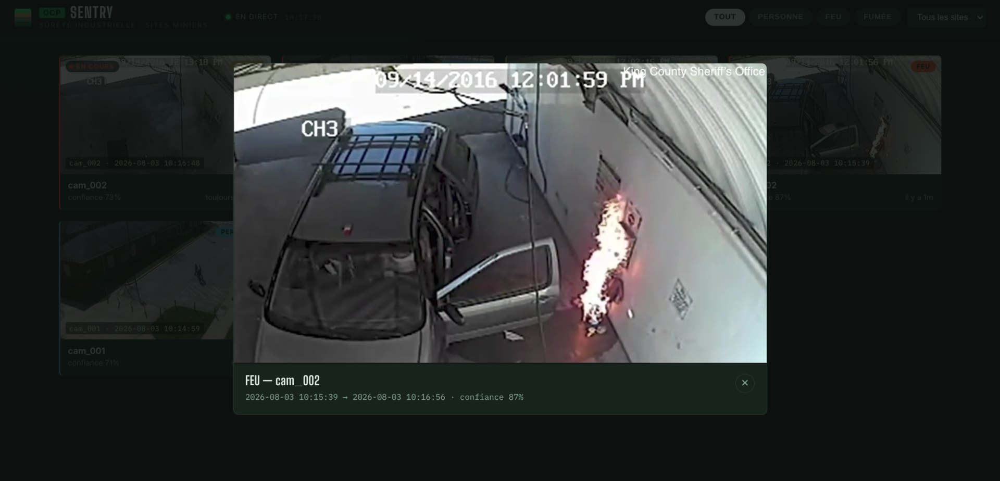
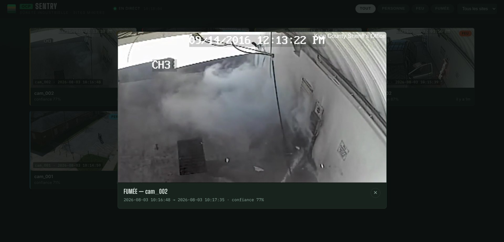

# OCP Sentry

**Real-time person, fire and smoke detection for camera feeds** — a self-hosted, from-scratch NVR built around a fine-tuned YOLOv8 model. It samples frames from your cameras, opens an *event* only when a detection is consistent (not on a single noisy frame), stitches the footage around it into a clip, and pushes the alert live to a web dashboard.



> Screenshots are taken from a running instance processing test video clips (two cameras: `cam_001` person, `cam_002` fire/smoke). The interface is currently in French.

## Features

- **Three-class detector** — `person`, `fire`, `smoke`, fine-tuned from COCO-pretrained YOLOv8 and served with ONNX Runtime (CPU by default, CUDA picked up automatically).
- **Debounced events** — an alert opens only after N consecutive detections and closes after a cooldown, so flicker doesn't spam you but a sustained fire does. Per-class confidence thresholds.
- **Full-quality clips** — footage is recorded continuously in short segments and cut into one clip per event (with pre/post-roll), plus a best-frame thumbnail.
- **Live dashboard** — alerts stream in over WebSocket; filter by class or camera, click a card to play the clip. Works on mobile.
- **Any source** — RTSP/IP cameras, a local webcam, or plain video files for demos.
- **Secure by default** — API-key auth on everything, secrets in `.env`, non-root containers, API bound to localhost, nginx as the only public entry point.
- **Reproducible training pipeline** — dataset prep (COCO person + D-Fire fire/smoke), training, evaluation and ONNX export, locally or on Google Colab.

## Screenshots

**Event playback** — click an alert card to open the stitched clip with its start/end time and confidence score.

| Person — `cam_001` | Fire — `cam_002` |
|---|---|
|  |  |

**Smoke — `cam_002`**



### Sample results

Observed end-to-end on the test videos (frame sampling → inference → debounce → clip → live dashboard):

| Camera | Class | Confidence | Observation |
|---|---|---|---|
| `cam_001` | person | 68–71 % | Stable detection for the whole time a person is in view |
| `cam_002` | fire | up to 87 % | Event opened on the first confirmed frames, closed after the cooldown |
| `cam_002` | smoke | 46–77 % | More variable confidence — smoke is the hardest class |

These are observations from a small functional test, not a benchmark; run `training/evaluate.py` for per-class mAP on your own validation set.

## How it works

```
camera RTSP streams
   │
   ├─ detect_url (sub-stream) ──► services/ingest ──► redis  frames:{camera}
   │                                                        │
   │                                                        ▼
   │                                          services/inference  (ONNX Runtime)
   │                                                        │
   │                                                        ▼
   │                                          redis  "detections" stream
   │                                                        │
   │                                                        ▼
   │                                      services/events  (debounce + clip stitching)
   │                                            │                       │
   │                                            ▼                       ▼
   └─ record_url (main stream) ──► segments   postgres "events"    redis "events" pub/sub
      on disk (storage/segments)        │                                │
                └─── stitched into ─► storage/clips                      ▼
                                                              services/api  (FastAPI REST + WebSocket)
                                                                         │
                                                                         ▼
                                                             frontend  (nginx + index.html)
```

| Service | Role |
|---|---|
| `ingest` | One ffmpeg pipeline per camera: samples frames from `detect_url` into Redis (a small C helper splits the MJPEG stream) and records `record_url` to rolling segment files. |
| `inference` | Reads sampled frames, runs the ONNX model, applies per-class thresholds, publishes detections. Can be sharded across replicas (`SHARD_COUNT` / `SHARD_INDEX`). |
| `events` | Debounce state machine per (camera, label); stitches clips with ffmpeg; writes events to Postgres and publishes them for live delivery. |
| `api` | FastAPI REST + WebSocket; serves clips and thumbnails. All routes need the API key. |
| `frontend` | nginx serving the single-page dashboard and proxying `/api`, `/ws`, `/clips`, `/thumbnails`. |

**Tech stack:** Python 3.11 · FastAPI · Redis 7 · PostgreSQL 16 · ONNX Runtime · OpenCV · FFmpeg · C · nginx · Docker Compose · Ultralytics YOLOv8 (training).

## Quick start

**Requirements:** Docker with the Compose plugin, and `curl`. A GPU is optional.

### 1. Clone and configure secrets

```bash
git clone https://github.com/itsya-ssine/OCP-Sentry.git
cd OCP-Sentry
cp .env.example .env
```

Fill in `POSTGRES_PASSWORD` and `API_KEY` in `.env` (the file has the commands to generate them). `.env` is git-ignored; the stack refuses to start without both values.

### 2. Choose a camera source

`config/cameras.yaml` is what the services read. It is git-ignored because RTSP URLs often contain credentials — start from a template:

| Source | Command |
|---|---|
| Real IP cameras (RTSP) | `cp config/cameras.example.yaml config/cameras.yaml`, then edit the URLs |
| Local webcam | `cp config/cameras.webcam.example.yaml config/cameras.yaml` |
| Video files, no hardware | `cp config/cameras.testvideos.example.yaml config/cameras.yaml` (see [`test_videos/`](test_videos/README.md)) |

For each camera, `detect_url` is a low-resolution sub-stream used for inference and `record_url` is the full-resolution stream used for recording and clips.

### 3. Provide a model

The ONNX model is not stored in git. Pick one:

- **Train your own** (person + fire + smoke) — see [Training](#training).
- **Quick test with a stock model** (detects `person` only):
  ```bash
  pip install ultralytics
  python training/export_pretrained.py
  ```
  and set `detection.classes_of_interest: ["person"]` in `config/settings.yaml`.
- **Bring your own** — drop `custom_model.onnx` and `custom_labelmap.txt` into `config/model/`. The model must be exported at 640×640 with NMS baked in (see `training/export.py`).

### 4. Start

```bash
./up.sh
```

This builds the base image and every service image, starts the stack, waits for the API health check and follows the logs. Open **http://localhost:8080/** — on first load it asks for the `API_KEY` from your `.env` and remembers it in the browser.

Useful variants: `./up.sh --no-build`, `./up.sh --detach`, `./build.sh`, `docker compose logs -f`, `docker compose down`.

<details>
<summary><b>Running against video files</b></summary>

```bash
./build.sh
docker compose -f docker-compose.yml -f docker-compose.testvideos.yml up -d
```
</details>

<details>
<summary><b>Running against a webcam</b></summary>

Docker Desktop on macOS/Windows cannot pass a webcam into a Linux container, so the two paths differ.

**Native Linux:**
```bash
./build.sh
docker compose -f docker-compose.yml -f docker-compose.webcam.example.yml up -d
```
If you get *Permission denied* on `/dev/video0`, find the device's group id with `stat -c '%g' /dev/video0`, set `VIDEO_GID` in `.env`, and rebuild.

**macOS / Windows:** run everything except `ingest` in Docker, and run ingest directly on the host (needs `ffmpeg` and `gcc`/`cc` installed locally):
```bash
# 1. publish Redis to the host: add this to the `redis` service in docker-compose.yml
#      ports: ["127.0.0.1:6379:6379"]
./build.sh
docker compose up -d redis postgres inference events api frontend

# 2. compile the MJPEG splitter and run ingest on the host
pip install -r requirements.txt
cc -O2 -o services/ingest/mjpeg_split services/ingest/mjpeg_split.c
NVR_ROOT=$(pwd) REDIS_HOST=localhost python services/ingest/ingest.py
```
On macOS use `avfoundation:0` instead of `v4l2:/dev/video0` in the camera config. Webcams usually can't be opened twice, so the template sets `record_enabled: false` — events then have a thumbnail but no clip.
</details>

## Configuration

Everything tunable lives in [`config/settings.yaml`](config/settings.yaml); connection details and secrets come from environment variables.

| Setting | Default | Meaning |
|---|---|---|
| `detection.frame_sample_fps` | `2` | Frames per second sampled from each camera for inference |
| `detection.per_class_thresholds` | person `0.6`, fire `0.45`, smoke `0.45` | Per-class confidence thresholds (fire/smoke usually need a lower bar) |
| `events.debounce_frames` | `3` | Consecutive detections needed to open an event |
| `events.cooldown_seconds` | `15` | Silence before an open event closes |
| `events.min_event_duration_seconds` | `1` | Shorter events are discarded |
| `events.pre_roll_seconds` / `post_roll_seconds` | `5` / `5` | Extra footage included around the event |
| `storage.segment_duration_seconds` | `10` | Length of each continuously recorded segment |
| `storage.segment_retention_hours` | `24` | Raw segments older than this are deleted |

Environment variables (`.env`): `POSTGRES_PASSWORD` and `API_KEY` (required), `CORS_ORIGINS` and `VIDEO_GID` (optional).

**GPU inference:** install `onnxruntime-gpu` in the image, and uncomment the `deploy:` block on the `inference` service in `docker-compose.yml` (requires the NVIDIA Container Toolkit).

## API

All routes require the key — `X-API-Key: <API_KEY>` header, or `?api_key=` for the WebSocket and media URLs. Only `/api/health` is open.

| Method | Path | Description |
|---|---|---|
| `GET` | `/api/health` | Liveness check |
| `GET` | `/api/cameras` | Configured cameras |
| `GET` | `/api/events` | List events — query params: `camera_id`, `label`, `since`, `limit` (1–200, default 50), `offset` |
| `GET` | `/api/events/{id}` | One event |
| `GET` | `/clips/…`, `/thumbnails/…` | Event media |
| `WS` | `/ws/alerts` | Live stream of `opened`, `closed` and `discarded` event messages |

```bash
curl -H "X-API-Key: $API_KEY" "http://localhost:8080/api/events?label=fire&limit=5"
```

## Training

The [`training/`](training/) directory fine-tunes YOLOv8 into the 3-class detector and exports it straight into `config/model/`:

```bash
cd training
pip install -r requirements.txt
python data/prepare_coco_person.py   # person-only COCO subset (via FiftyOne)
python data/prepare_dfire.py         # D-Fire fire/smoke (Kaggle mirror, needs Kaggle credentials)
python data/merge_datasets.py        # merge + train/val split
python train.py
python evaluate.py                   # per-class mAP
python export.py                     # -> ../config/model/custom_model.onnx
```

No GPU? Use [`training/run_training_on_colab.ipynb`](training/run_training_on_colab.ipynb). Full details in [`training/README.md`](training/README.md); hyper-parameters are in [`training/configs/train_config.yaml`](training/configs/train_config.yaml).

Fire and smoke are harder than people. Expect to iterate — add hard negatives (sunsets, orange clothing, steam) and feed false positives from your own cameras back into the dataset.

## Security

This stack serves live camera footage, so before exposing it beyond localhost:

- **Everything needs the API key** — REST, WebSocket and media. The dashboard stores it in the browser's `localStorage`.
- **Secrets live in `.env`**, never in the repo. Services fail fast at startup if they're missing; the API also rejects keys shorter than 16 characters.
- **Only nginx is public.** The API is published on `127.0.0.1:8000` for local debugging; the dashboard on `:8080`. If you put this on the internet, add a real reverse proxy with **TLS** in front of 8080.
- **Containers run as a non-root user** (uid/gid 1000; override with `--build-arg APP_UID/APP_GID` if your host user differs and `./storage` isn't writable).
- **CORS is closed by default** (same-origin through nginx).
- nginx adds baseline hardening headers (CSP, `X-Frame-Options`, `nosniff`, …).

## Project layout

```
.
├── common/                shared code: config loader, Postgres schema, Redis helper,
│                          optional shared-memory frame bus (shm_ring.*)
├── config/
│   ├── settings.yaml      thresholds, event timing, storage, retention
│   ├── cameras.*.yaml     camera templates (copy one to cameras.yaml)
│   └── model/             ONNX model + labelmap (model file not tracked)
├── services/
│   ├── ingest/            ffmpeg sampling + segment recording
│   ├── inference/         ONNX inference worker
│   ├── events/            debounce, clip stitching, Postgres writes
│   └── api/               FastAPI REST + WebSocket
├── frontend/index.html    alerts dashboard
├── training/              dataset prep, training, evaluation, export
├── storage/               clips, segments, thumbnails (runtime output)
├── docs/screenshots/      README images
├── docker-compose.yml     redis, postgres, ingest, inference, events, api, frontend
├── docker-compose.*.yml   optional overrides: test videos, webcam
├── Dockerfile.base        shared python + ffmpeg base image
├── nginx.conf             static serving + reverse proxy
└── build.sh / up.sh       build and start scripts
```

## Known limitations

- `storage.clip_retention_days` exists in the settings but automatic deletion of old **clips** is not implemented yet — only raw segments are pruned. Clean `storage/clips/` yourself for now.
- The dashboard UI is French only.
- `common/shm_ring.*` (a lock-free shared-memory frame bus) is a standalone building block, not wired into ingest/inference — frames still flow through Redis.
- Inference runs frames one at a time (NMS is baked into the model); scale out with sharded replicas rather than bigger batches.
- There is no automated test suite yet; CI only checks syntax, config validity and that the C sources compile.

## License

[MIT](LICENSE)
